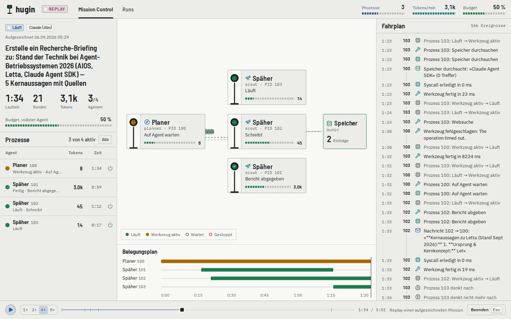
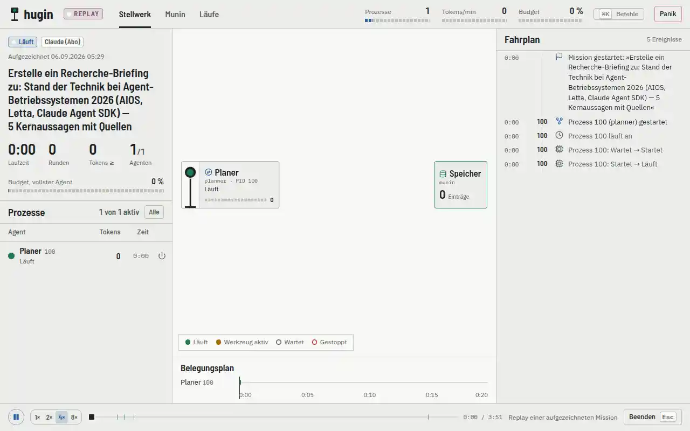
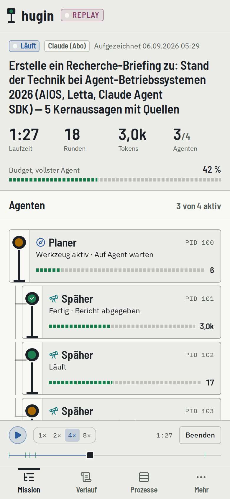

# hugin

[](https://github.com/sutheimernico/hugin/actions/workflows/ci.yml)

**hugin is a local agent runtime: a Python kernel runs AI agents — `claude -p` subprocesses or a
local Ollama loop — as supervised processes with PIDs, budgets, capability-gated syscalls and an
append-only event log, and a React UI shows, kills and replays every step live.**

<p align="center">
  
</p>

<p align="center">
  <sub>The real Claude run recorded for this repo (848 events, 231 s) at 1:09. You can replay it
  without a kernel: <code>npm --prefix frontend run build:pages</code> builds a replay-only shell
  that opens on this run (see below).</sub>
</p>

**Headline result.** The largest real run so far: one planner plus three web-searching scouts on
a Claude subscription — 848 events, 51 turns, 231 s, five memories, one `report.md`. API-equivalent
cost $1.12, billed 0 €: no API key is ever used, the kernel strips it from every agent
environment and refuses to start the Claude driver if it finds one in its own.

**Quick start**

```bash
uv sync                                   # Python environment
npm --prefix frontend ci                  # frontend dependencies
npm --prefix frontend run build           # builds frontend/dist
scripts/serve.sh                          # -> http://127.0.0.1:8770
```

Press ⌘K / Ctrl+K, pick a driver (Simulation needs nothing installed), type a goal. The UI copy
is German; code, docs and commits are English.

**Try it without a kernel.** `npm --prefix frontend run build:pages` builds the replay-only shell
into `frontend/dist-pages/`: no backend, no stream, it opens on the recorded Claude run and lists
the other recordings. `.github/workflows/pages.yml` deploys exactly that to GitHub Pages
(Settings → Pages → Source: GitHub Actions, once).

## The interface

<p align="center">
  
</p>

<p align="center">
  <sub>The whole recorded run as a 15 s time-lapse at about 16x (animated WebP, 1280 px, full
  colour, captured by stepping the replay timeline). Its in-flight token counter still reads <code>Tokens ≥</code>: the
  recording predates the exact counter, and the exit totals are correct.</sub>
</p>

The shell is a railway signal box, because hugin does what a signal box does: it supervises
processes and shows who holds which section. Every agent is a block with a signal mast in front of
it, the spawn tree is track laid out left to right, and messages travel it as trains. The lamp is
the only place state gets a colour (green runs, amber waits for a tool, red failed or stopped, dark
is queued). A kill reads as two beats, `TERM` and `KILL`. The event stream is a timetable, the
mission a ledger, and the occupancy plan under the diagram shows *when* each agent held a slot.
The concept, tokens, type and motion rules are in
[`docs/design/redesign-2026-10.md`](docs/design/redesign-2026-10.md).

<p align="center">
  
</p>

The three columns hold down to 900 px (a 960 px laptop at 200 % scaling is the design target for
the narrow end); between 720 and 900 px the diagram stacks above two columns, and below 720 px it is
redrawn as a vertical process tree instead of being squeezed, the agent window becomes a
full-height sheet, and navigation moves to a bottom bar. Transitions are 150 to 400 ms, transform
and opacity only; the one looping motion is a slow 2.4 s ring on the lamp of a running agent.
All of it is switched off under `prefers-reduced-motion`. The design research is in
[`docs/design-brief.md`](docs/design-brief.md). Views other than
Mission Control, the command palette and the boot sequence load as separate chunks.

## What it is — and what it is not

hugin borrows an operating system's *process model*, not its kernel: agents get a PID, a state
machine (`queued → spawning → running ⇄ waiting_tool → done | failed | killed`), a working
directory, hard budgets (turns, seconds, output tokens), a capability set and a kill switch. The "scheduler" is a FIFO
concurrency limiter per driver (21 lines), not a time-slicing scheduler. There is no auth and no
multi-user mode; it binds to 127.0.0.1 and trusts the person at the keyboard. See
[`docs/THREAT_MODEL.md`](docs/THREAT_MODEL.md) for what that does and does not cover.

Real: the processes are real `claude -p` subprocesses or a real Ollama tool loop, the syscalls
are real MCP tools, and the event log is the source of truth. Simulated: exactly one driver — the
*Simulation* replays a fixed script instead of calling a model, so tests and the offline demo run
without an LLM. It plays the same example mission whatever goal you type (the UI says so), and the
mode chip reads `SIMULATION`, `LIVE · CLAUDE`, `LIVE · OLLAMA` or `REPLAY` while a mission or a replay is on screen, and `BEREIT` (ready) when the kernel is idle (`AUFZEICHNUNGEN` in the replay-only build, which has no kernel).

## How this was built

hugin was built with spec-driven agentic development. I wrote the design spec and the plan
(`docs/superpowers/specs/`, `docs/superpowers/plans/`), set the constraints (no API cost, no
network or LLM in tests, capability gate on every syscall), reviewed what the coding agents
produced, and own the verification: 398 backend tests and 341 frontend tests are the gate, run on
every push by CI. The architecture decisions that were not obvious are written down as ADRs in
`docs/adr/`. A later audit pass found real problems in that first version — stale tokens, an
unbounded child budget, an over-broad file tool, a log that was not actually used to rebuild state
— and fixed them with a failing test each; the threat model records what is still open.

## Architecture

```
┌──────────────────────────── Browser (React 19) ────────────────────────────────────┐
│ Boot · Mission Control (process table · signal-box diagram · timetable) · Agent ·   │
│ Munin browser · Runs & Replay (scrubber) · ⌘K palette · replay-only Pages build     │
│                     ▲ SSE /api/events/stream  · REST /api/*                          │
└─────────────────────┼───────────────────────────────────────────────────────────────┘
┌─────────────────────┼──────────── FastAPI (port 8770) — src/hugin ──────────────────┐
│ api/  ──────────────┘   (loopback Host/Origin guard)                                 │
│ kernel/   EventBus → EventLog (SQLite) · ProcessTable · concurrency limiter · Budgets│
│ drivers/  ScriptedDriver · ClaudeCodeDriver (claude -p stream-json) · OllamaDriver   │
│ syscalls/ capability-gated kernel calls, exposed to agents as MCP tools (/mcp)       │
│ munin/    memory store (SQLite FTS5) · programs/ (YAML agent definitions)            │
│ missions/ planner → workers → report · replay/ recorder + time-scaled player         │
└───────┬──────────────────────────────┬───────────────────────────────────────────────┘
        │ subprocess per agent          │ HTTP /api/chat (stream, tools)
   claude -p … (isolated config dir)   Ollama (qwen2.5:7b)
```

- **Event sourcing.** Every state change is an immutable `Event` (24 closed kinds, a pydantic
  payload each), written to SQLite before it is published. The UI derives its state from nothing
  else, and a restarted kernel folds runs and processes back out of the log — old runs stay
  listed and replayable; a run the previous kernel left open is closed as `interrupted`.
- **Kernel, processes, budgets.** Per-process budgets (turns, seconds, output tokens); a watcher
  kills on breach with `exit_reason="budget:<which>"`. A child's budget is capped by what its
  parent has left, and killing a parent kills its children. The panic button stops everything.
- **Three drivers behind one protocol** (`run(proc, prompt, sink)`): scripted, Claude Code and
  Ollama. A driver knows neither the process table nor the database.
- **Syscalls as MCP tools.** Six kernel calls (`munin_search`, `munin_write`, `proc_spawn`,
  `proc_wait`, `mission_report`, `artifact_write`) sit behind a capability check and reach agents
  over Streamable HTTP at `/mcp`. Each process authenticates with its own token, issued at spawn
  and revoked at exit; it is passed to `claude` through a private file, not the command line.
- **munin.** SQLite FTS5 memory shared by all runs, bm25 ranking, no embeddings. Results are
  marked untrusted when an agent reads them.
- **Replay is a projection.** Replaying a run folds the same log through the same reducer as the
  live view; the player only paces the gaps.

## Drivers

| Driver | Needs | Speed | Mode chip |
| --- | --- | --- | --- |
| **Claude (subscription)** | `claude` CLI logged in; no `ANTHROPIC_API_KEY` in the kernel's environment | research mission with 3 scouts ≈ 231 s | `LIVE · CLAUDE` |
| **Ollama (local)** | Ollama with `qwen2.5:7b` | CPU only ≈ 5 tokens/s, minutes per mission | `LIVE · OLLAMA` |
| **Simulation** | nothing | ≈ 8 s, deterministic, fixed script | `SIMULATION` |

An unavailable driver is disabled in the palette with the reason, and `POST /api/missions`
answers 409 instead of silently falling back. Honest limit: in five demo runs the 7B Ollama
planner never completed a multi-agent run (60-second child budgets, tool calls written as text,
looping until the 900 s budget). Ollama is stable as a single program (`program:scout <task>`);
the planner needs Claude or the simulation.

## Security model (short)

Full version: [`docs/THREAT_MODEL.md`](docs/THREAT_MODEL.md).

- Loopback only; `/api` and `/mcp` both refuse non-loopback `Host`/`Origin` (DNS rebinding). To open
  the shell from another device (e.g. a phone over Tailscale), bind `HUGIN_HOST` there and name the
  hostnames you accept in `HUGIN_ALLOWED_HOSTS` (comma-separated, exact match; default: none).
- File tools are path-scoped to `HUGIN_WORKSPACE_ROOT` (default: this repository), the hugin state
  directory, the Claude config directory and `.env` files are on a deny list, no program has a
  shell tool, and every spawn path checks task text against the workspace. The path and deny
  rules follow Claude Code's documented syntax and are asserted in tests, but **have not been
  probed live**: the owner still has to run one real `smith` mission whose task points outside the
  workspace and at a `.env`, and confirm the refusal in the transcript (open item,
  `docs/THREAT_MODEL.md` R1).
- Per-program tool whitelist, `--permission-mode dontAsk`, `--strict-mcp-config`, an isolated
  `CLAUDE_CONFIG_DIR` (no user hooks, MCP servers or CLAUDE.md), a scrubbed environment.
- Capability gate before every syscall; only a run's planner may write its artifact, and not
  after the run is closed.
- Recordings are scrubbed (home paths masked, export refused if anything looks like a key).

Not covered: a hostile web page can still mislead a scout's *text*; there is no authentication.

## Replay and demo recordings

Any run can be replayed, also after a restart. A run worth keeping is exported as a recording
(`.jsonl` events plus a `.json` manifest) under `demo/recordings/`:

```bash
curl -X POST 127.0.0.1:8770/api/recordings/<run_id> -H 'content-type: application/json' \
     -d '{"slug": "my-run"}'
uv run python scripts/record_demo.py <run_id> <slug>      # or straight from the database
```

| Slug | Driver | Events | Duration |
| --- | --- | --- | --- |
| `simulation-research-brief` | Simulation | 127 | 7.6 s |
| `claude-research-brief` | Claude (subscription) | 848 | 231.5 s |
| `ollama-scout-brief` | Ollama (`program:scout`) | 462 | 242.0 s |

Note on the Claude recording: it was captured before output tokens were counted from the stream's
`message_delta` (the first version read a start-of-message snapshot of ~1 token per turn). Its live
token readings while agents run are therefore far too low, and the UI marks that figure as a lower
bound (`Tokens ≥`, only for recordings flagged `tokens_lower_bound` in their manifest) until the agents exit; the exit totals (20,2k output tokens) are exact. New
runs count per turn from the stream.

## Development

```bash
uv run pytest -q                          # 398 tests
uv run ruff check . && uv run ruff format --check .
uv run mypy                               # type check
npm --prefix frontend run check           # tsc + eslint
npm --prefix frontend test -- --run       # 341 tests
```

CI (`.github/workflows/ci.yml`) runs exactly these. No test talks to the network, to `claude` or
to Ollama: the kernel runs on the scripted driver, subprocesses behind a fake factory, Ollama
behind `httpx.MockTransport`. Frontend hot reload: `scripts/serve.sh` plus
`npm --prefix frontend run dev` (http://127.0.0.1:5177, proxies `/api`). Settings are `HUGIN_*`
environment variables, see `.env.example`.

```
src/hugin/kernel/      events · log · restore · bus · process · budget · scheduler · kernel · sink
src/hugin/drivers/     base · scripted · stream_json · claude_code · ollama · scripts/*.json
src/hugin/syscalls/    registry · handlers · mcp_server        src/hugin/workspace.py  path rule
src/hugin/munin/       FTS5 store     src/hugin/programs/  *.yaml + contract.md
src/hugin/missions/    lifecycle      src/hugin/replay/    player · recorder
src/hugin/api/         routes_* · SSE · loopback guard        src/hugin/system/  subsystem status
frontend/src/state/    types · reducer · store · selectors (the projection)
frontend/src/features/ boot · shell · procs · log (timetable) · graph · agent · palette · munin · replay
docs/                  THREAT_MODEL.md · adr/ · superpowers/{specs,plans} · media/
```

## Status and later

v1 is feature-complete: kernel, three drivers, MCP syscalls, munin, five programs, missions,
replay and six views. Not in v1, written down on purpose: 3D constellation view, sound cues, an
embeddings track in munin, scheduled missions, run comparison, an installable PWA, authentication, a
Tauri shell, a git worktree per run, agent-to-agent messaging (`proc_send` was removed: a
`claude -p` process cannot receive a message mid-run).

## License

MIT — see `LICENSE`.
